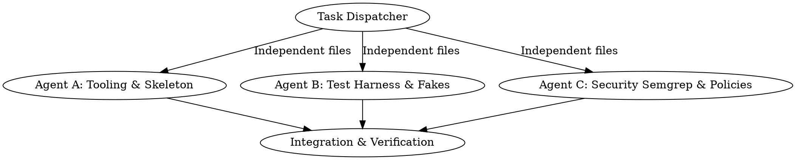

# TechRadar Brain: Master Implementation & Development Tracker

**Status:** Initializing Mac Development (Linux Server Deferred)  
**Target Environment:** MacBook Air M4 (Active Development) ➔ ASUS TUF A15 Linux (Production Deployment)  
**Security Baseline:** SEC-01 through SEC-68 (Strict Zero-Inbound, Least-Privilege, Sandbox Verification)

---

## 1. Hardware & Execution Boundary Strategy

Because development is starting on the **MacBook Air M4** while the **ASUS TUF A15 (Linux)** server is not currently available:

| Subsystem | Mac Development Execution (Now) | Linux Server Deployment (Later) |
|---|---|---|
| **Language & Environment** | Python 3.14 via `uv`, src layout `src/techradar` | Same Python/uv in Docker images |
| **Testing Harness** | Unit tests run via mock protocols (`fakes.py`) without requiring Docker/Postgres | Integration tests run against containerized Postgres + pgvector |
| **Database** | In-memory/SQLite fakes for unit tests, local Postgres or Docker when available | Production PostgreSQL 18 + pgvector + pgaudit |
| **Local Models** | Native Mac Ollama (Gemma 4 E2B, Qwen3.5-4B) / Fake LLM completers | Ollama on NVIDIA RTX 3060 Laptop GPU (6GB VRAM) |
| **Frontend** | Next.js 16 (App Router), Tailwind v4, shadcn/ui, Three.js Orb on Node 20 | Next.js running in Docker behind Tailscale Serve HTTPS |
| **Intake Gateway** | Native Python sandbox logic (libmagic, pdfid, YARA, text normalization) | ClamAV daemon container, no-network parser container |
| **Security & Auditing** | Static checks: semgrep, ruff, gitleaks, `check_deps.py`, `check_mcp.py` | Host daemons: Falco (eBPF), auditd, AIDE, Lynis, Alerter |
| **Voice Engine** | Web Audio API, openWakeWord, Kokoro ONNX, faster-whisper (CPU/Metal) | Pipecat WebRTC live pipeline on GPU |

---

## 2. Phase-by-Phase Master Roadmap

### Phase 1: Secure Foundation (`docs/superpowers/plans/2026-11-07-techradar-phase1-foundation.md`)
**Gate Criteria:** `make gate-1` passes (lint, tests, policy checks, fake bot, config validation)

- [ ] **Task 1: Repository skeleton, tooling and agent rules** `[Mac Ready]`
  - *Files:* `pyproject.toml`, `.python-version`, `.gitignore`, `.pre-commit-config.yaml`, `AGENTS.md`, `README.md`, `.env.example`, `secrets.example/`, `src/techradar/__init__.py`, `tests/test_smoke.py`
  - *SEC:* SEC-11, SEC-34
  - *Verify:* `git init`, `uv run pytest tests/test_smoke.py` passes.
- [ ] **Task 2: Testing harness, fakes and unit baseline** `[Mac Ready]`
  - *Files:* `tests/fakes.py`, `tests/conftest.py`, `tests/unit/test_fakes.py`
  - *SEC:* Protocol abstractions (`Completer`, `Embedder`, `Resolver`, `Clock`)
  - *Verify:* Unit tests verify fake models without network or real GPUs.
- [ ] **Task 3: Settings, secrets reader and environment validation** `[Mac Ready]`
  - *Files:* `src/techradar/config.py`, `tests/unit/test_config.py`
  - *SEC:* SEC-10, SEC-35 (`TR_ALLOW_CLOUD_LLM=false`, strip whitespace from secrets)
  - *Verify:* Secret reading strips CRLF/spaces; invalid environments fail fast.
- [ ] **Task 4: Database schema, least-privilege roles and migrations** `[Mac Ready / Linux Integration]`
  - *Files:* `alembic.ini`, `migrations/`, `src/techradar/db/`, `tests/unit/test_db_models.py`
  - *SEC:* SEC-12 (Separate app, migrator, and read-only roles)
  - *Verify:* SQLAlchemy 2 models validate cleanly with psycopg 3 types.
- [ ] **Task 5: Model routing and LiteLLM abstraction** `[Mac Ready]`
  - *Files:* `src/techradar/models/router.py`, `tests/unit/test_model_router.py`
  - *SEC:* SEC-23 (GGUF/safetensors validation, no pickle, no trust_remote_code)
  - *Verify:* Worker/checker routing correctly separates model families.
- [ ] **Task 6: Local model fit test bench** `[Mac Ready (Mac models) / Linux (GPU)]`
  - *Files:* `evals/fit/test_fit.py`, `infra/models/approved_models.yaml`
  - *SEC:* SEC-23, Decision D6
  - *Verify:* Evaluates context limits, VRAM projections, and speed thresholds.
- [ ] **Task 7: Docker Compose architecture and policy tests** `[Mac Ready]`
  - *Files:* `docker-compose.yml`, `tests/security/test_compose_policy.py`
  - *SEC:* SEC-01, SEC-02, SEC-06, SEC-07, SEC-55 (Pinned SHA-256 digests, 127.0.0.1 bindings)
  - *Verify:* Policy test asserts zero ports bound to 0.0.0.0 and all digests present.
- [ ] **Task 8: Squid egress proxy configuration and allowlists** `[Mac Ready / Linux Integration]`
  - *Files:* `infra/squid/squid.conf`, `infra/squid/allowlist.txt`, `tests/unit/test_squid_conf.py`
  - *SEC:* SEC-05, SEC-25, SEC-59 (Outbound allowlist only; logging deny alarms)
  - *Verify:* Configuration blocks internal IP access and non-allowlisted domains.
- [ ] **Task 9: Logging and PII redaction** `[Mac Ready]`
  - *Files:* `src/techradar/logging.py`, `tests/unit/test_logging.py`
  - *SEC:* SEC-32 (Redact tokens, chat IDs, emails, auth headers)
  - *Verify:* Formatter scrubs credentials before output.
- [ ] **Task 10: Owner-only Telegram bot skeleton & `/status`** `[Mac Ready]`
  - *Files:* `src/techradar/bot/`, `tests/unit/test_bot_router.py`
  - *SEC:* SEC-26 (Strict owner chat ID check; strangers get zero response)
  - *Verify:* Non-owner messages ignored; `/status` returns clean system summary.
- [ ] **Task 11: Encrypted backup scripts with restic** `[Mac Ready (Scripts) / Linux (Cron)]`
  - *Files:* `infra/backup/backup.sh`, `tests/unit/test_backup_script.py`
  - *SEC:* SEC-14 (Encrypted snapshots, exclude honeytokens)
  - *Verify:* Dry-run backup script generates valid restic commands.
- [ ] **Task 12: CI security workflow and static analysis** `[Mac Ready]`
  - *Files:* `.github/workflows/ci.yml`, `Makefile`, `security/semgrep/`
  - *SEC:* SEC-33 (Pinned GitHub Actions commit SHAs, gitleaks, ruff, semgrep)
  - *Verify:* `make lint` and `make security` execute without errors.
- [ ] **Task 13: Dependency approval and MCP allowlists** `[Mac Ready]`
  - *Files:* `infra/policy/approved_deps.yaml`, `infra/policy/check_deps.py`, `infra/policy/check_mcp.py`
  - *SEC:* SEC-52, SEC-53 (Blocks typosquatting, slopsquatting, unvetted agent plugins)
  - *Verify:* CI script fails if an unapproved package is added to `pyproject.toml`.
- [ ] **Task 14: Host Alerter daemon, heartbeat, and egress alarms** `[Mac Ready (Scripts) / Linux (Host)]`
  - *Files:* `infra/host/alerter.py`, `tests/unit/test_alerter.py`
  - *SEC:* SEC-59, SEC-66 (Separate bot token, daily 06:25 AM heartbeat, deduplication)
  - *Verify:* Alerter formats alarms, dedupes bursts, and logs to append-only file.
- [ ] **Task 15: Honeytokens, host integrity checks & auditing** `[Mac Ready (Templates) / Linux (Host)]`
  - *Files:* `infra/host/plant_honeytokens.sh`, `infra/host/integrity_check.sh`, `tests/unit/test_integrity.py`
  - *SEC:* SEC-60, SEC-61, SEC-62, SEC-63 (AIDE, auditd, pgaudit, fake credentials)
  - *Verify:* Scripts correctly configure honeytoken paths and exclude them from backups.
- [ ] **Task 16: Falco configuration and containment rules** `[Mac Ready (Rules) / Linux (Host eBPF)]`
  - *Files:* `infra/falco/falco_rules.local.yaml`, `tests/unit/test_falco_rules.py`
  - *SEC:* SEC-58, SEC-65 (Alert on unexpected shells, container isolation)
  - *Verify:* Rule syntax passes linter; containment logic isolates containers safely.
- [ ] **Task 17: Phase 1 gate verification (`make gate-1`)** `[Mac Ready]`
  - *Files:* `scripts/gate_1_check.py`
  - *Verify:* Full automated pass of all unit, security, and policy tests.

---

### Phase 2: Secure Ingest & Markdown Vault (`docs/superpowers/plans/2026-11-07-techradar-phase2-ingest.md`)
**Gate Criteria:** `make gate-2` passes (Intake Gateway, sanitized feed parsing, LangGraph pipeline)

- [ ] **Task 1: Intake Gateway file-type & structural scanning** `[Mac Ready]`
  - *Files:* `src/techradar/intake/scanner.py`, `tests/unit/test_scanner.py`
  - *SEC:* SEC-43, SEC-57 (libmagic byte verification, reject polyglots, pdfid checks)
- [ ] **Task 2: Antivirus client & ClamAV daemon socket wrapper** `[Mac Ready (Client) / Linux (Daemon)]`
  - *Files:* `src/techradar/intake/clamav.py`, `tests/unit/test_clamav_client.py`
  - *SEC:* SEC-57 (Fail-closed on socket error or outdated signatures)
- [ ] **Task 3: Text normalization & invisible character stripping** `[Mac Ready]`
  - *Files:* `src/techradar/security/text.py`, `tests/unit/test_text_security.py`
  - *SEC:* SEC-17 (Strip zero-width characters, normalize Unicode, sanitize HTML)
- [ ] **Task 4: Prompt injection classifier integration** `[Mac Ready]`
  - *Files:* `src/techradar/intake/injection.py`, `tests/unit/test_injection_guard.py`
  - *SEC:* SEC-57 (Llama Prompt Guard 2 / DeBERTa threshold evaluation)
- [ ] **Task 5: Feed fetching engine & RSS client** `[Mac Ready]`
  - *Files:* `src/techradar/ingest/fetcher.py`, `tests/unit/test_fetcher.py`
  - *SEC:* SEC-05, SEC-25 (Respect robots.txt, domain allowlist, rate limits)
- [ ] **Task 6: Clean article extraction sandbox (trafilatura & Docling)** `[Mac Ready]`
  - *Files:* `src/techradar/ingest/parser.py`, `tests/unit/test_parser.py`
  - *SEC:* SEC-06, SEC-07 (Isolated extraction, memory/process limits)
- [ ] **Task 7: Deduplication & cosine similarity filter** `[Mac Ready]`
  - *Files:* `src/techradar/ingest/dedupe.py`, `tests/unit/test_dedupe.py`
  - *SEC:* Cosine threshold 0.90 with BGE-M3 embeddings
- [ ] **Task 8: LangGraph reader step (tool-less model extraction)** `[Mac Ready]`
  - *Files:* `src/techradar/pipeline/reader.py`, `tests/unit/test_reader_node.py`
  - *SEC:* SEC-16 (Model has zero tools; outputs validated Pydantic schema)
- [ ] **Task 9: Cross-model verification node (Gemma writes, Qwen checks)** `[Mac Ready]`
  - *Files:* `src/techradar/pipeline/checker.py`, `tests/unit/test_checker_node.py`
  - *SEC:* SEC-20 (Dual-model validation, 2+ source rule)
- [ ] **Task 10: Outdated facts & superseded data tracking** `[Mac Ready]`
  - *Files:* `src/techradar/pipeline/facts.py`, `tests/unit/test_facts.py`
  - *SEC:* SEC-20, Decision D40 (Official facts supersede older records)
- [ ] **Task 11: Markdown vault writer & frontmatter generator** `[Mac Ready]`
  - *Files:* `src/techradar/vault/writer.py`, `tests/unit/test_vault_writer.py`
  - *SEC:* SEC-24 (Path traversal prevention, safe filename slugification)
- [ ] **Task 12: Syncthing vault folder structure initialization** `[Mac Ready]`
  - *Files:* `vault/Syllabus/`, `vault/Foundation/`, `vault/Radar/`, `vault/Clippings/`
- [ ] **Task 13: Red-team prompt injection test suite** `[Mac Ready]`
  - *Files:* `tests/security/test_injection_redteam.py`
  - *SEC:* Validate that hidden instructions in documents never trigger tool calls
- [ ] **Task 14: Phase 2 gate verification (`make gate-2`)** `[Mac Ready]`

---

### Phase 2b: RAG Knowledge Index & Ask (`docs/superpowers/plans/2026-11-07-techradar-phase2b-rag.md`)
**Gate Criteria:** `make gate-2b` passes (hybrid search, reciprocal rank fusion, citation checking)

- [ ] **Task 1: Chunking engine with contextual breadcrumbs** `[Mac Ready]`
  - *Files:* `src/techradar/rag/chunker.py`, `tests/unit/test_chunker.py`
- [ ] **Task 2: Postgres vector + BM25 hybrid index** `[Mac Ready (Unit) / Linux (pgvector)]`
  - *Files:* `src/techradar/rag/indexer.py`, `tests/unit/test_indexer.py`
- [ ] **Task 3: BGE-reranker cross-encoder integration** `[Mac Ready]`
  - *Files:* `src/techradar/rag/reranker.py`, `tests/unit/test_reranker.py`
- [ ] **Task 4: LangGraph `/ask` synthesis pipeline** `[Mac Ready]`
  - *Files:* `src/techradar/pipeline/ask.py`, `tests/unit/test_ask_pipeline.py`
- [ ] **Task 5: Citation verifier & hallucination guard** `[Mac Ready]`
  - *Files:* `src/techradar/rag/citation_check.py`, `tests/unit/test_citations.py`
  - *SEC:* SEC-18 (Every claim must match source chunk word-for-word)
- [ ] **Task 6: Bot `/ask` command handler with Telegram outbox** `[Mac Ready]`
  - *Files:* `src/techradar/bot/commands/ask.py`, `tests/unit/test_ask_command.py`
  - *SEC:* Decision D22 (Outbox pattern; workers never hold Telegram tokens)
- [ ] **Task 7: Retrieval evaluation suite (Ragas / DeepEval)** `[Mac Ready]`
  - *Files:* `evals/rag/eval_retrieval.py`
- [ ] **Task 8: Phase 2b gate verification (`make gate-2b`)** `[Mac Ready]`

---

### Phase 2c: The Library (Large PDFs, Videos & Study Packs) (`docs/superpowers/plans/2026-11-08-techradar-phase2c-library.md`)
**Gate Criteria:** `make gate-2c` passes (resumable bulk queue, 25-page PDF chunking, media sandboxing)

- [ ] **Task 1: Library directory layout & Syncthing receive-only inbox** `[Mac Ready]`
  - *Files:* `data/library-inbox/`, `data/library/originals/`, `data/library/text/`
  - *SEC:* SEC-43 (Library folder excluded from news retention deletion)
- [ ] **Task 2: Procrastinate `bulk` queue configuration** `[Mac Ready]`
  - *Files:* `src/techradar/queue/bulk.py`, `tests/unit/test_bulk_queue.py`
- [ ] **Task 3: Docling 25-page segmented PDF processor** `[Mac Ready]`
  - *Files:* `src/techradar/library/pdf_chunker.py`, `tests/unit/test_pdf_chunker.py`
- [ ] **Task 4: ffmpeg audio & slide frame extractor sandbox** `[Mac Ready (Logic) / Linux (Sandbox)]`
  - *Files:* `src/techradar/library/video_extractor.py`, `tests/unit/test_video_extractor.py`
  - *SEC:* SEC-44 (`-protocol_whitelist file`, reject playlists, no network)
- [ ] **Task 5: Chapter summary generator & vault note creator** `[Mac Ready]`
  - *Files:* `src/techradar/library/summarizer.py`, `tests/unit/test_summarizer.py`
- [ ] **Task 6: Starter pack downloader (NCERT, NIOS, RBI, Budget)** `[Mac Ready]`
  - *Files:* `infra/sources/exam_packs.yaml`, `src/techradar/library/starter_packs.py`
  - *SEC:* Downloads only after explicit allowlist approval
- [ ] **Task 7: "Ask this PDF" scoped RAG query engine** `[Mac Ready]`
  - *Files:* `src/techradar/rag/scoped_ask.py`, `tests/unit/test_scoped_ask.py`
- [ ] **Task 8: Phase 2c gate verification (`make gate-2c`)** `[Mac Ready]`

---

### Phase 3: Daily Briefing, Practice & Exam Alerts (`docs/superpowers/plans/2026-11-07-techradar-phase3-briefing-practice.md`)
**Gate Criteria:** First usable MVP (Telegram daily briefing, FSRS flashcard engine, MCQs, website watcher)

- [ ] **Task 1: Morning briefing generator (Tech, India, World, Economy, Science, Daily Life)** `[Mac Ready]`
  - *Files:* `src/techradar/briefing/generator.py`, `tests/unit/test_briefing.py`
- [ ] **Task 2: "My take" user opinion & prediction tracker** `[Mac Ready]`
  - *Files:* `src/techradar/practice/predictions.py`, `tests/unit/test_predictions.py`
- [ ] **Task 3: MCQ generator with 2-model cross-validation** `[Mac Ready]`
  - *Files:* `src/techradar/practice/mcq.py`, `tests/unit/test_mcq.py`
  - *SEC:* SEC-20 (Generated strictly from verified facts)
- [ ] **Task 4: py-fsrs spaced repetition flashcard scheduler** `[Mac Ready]`
  - *Files:* `src/techradar/practice/fsrs.py`, `tests/unit/test_fsrs.py`
  - *SEC:* Daily caps: 10 new cards, 40 reviews (FSRS optimizer)
- [ ] **Task 5: "Mark chapter as read" event trigger** `[Mac Ready]`
  - *Files:* `src/techradar/practice/chapter_cards.py`, `tests/unit/test_chapter_cards.py`
- [ ] **Task 6: Mistakes notebook & review loop** `[Mac Ready]`
  - *Files:* `src/techradar/practice/mistakes.py`, `tests/unit/test_mistakes.py`
- [ ] **Task 7: Grammar & vocabulary daily practice generator** `[Mac Ready]`
  - *Files:* `src/techradar/practice/grammar.py`, `tests/unit/test_grammar.py`
- [ ] **Task 8: changedetection.io exam notification watcher integration** `[Mac Ready (Client) / Linux (Container)]`
  - *Files:* `src/techradar/exams/watcher.py`, `tests/unit/test_watcher.py`
- [ ] **Task 9: Bot interactive quiz & card review session handlers** `[Mac Ready]`
  - *Files:* `src/techradar/bot/commands/quiz.py`, `src/techradar/bot/commands/cards.py`
- [ ] **Task 10: Phase 3 gate verification (`make gate-3`)** `[Mac Ready]`

---

### Phase 4: Web Application v1 (`docs/superpowers/plans/2026-11-07-techradar-phase4-web-app.md`)
**Gate Criteria:** Next.js 16 UI over Tailscale HTTPS with streaming answers, CSRF protection, and confirmation tickets

- [ ] **Task 1: Next.js 16 + Tailwind v4 + shadcn/ui application scaffold** `[Mac Ready]`
  - *Files:* `apps/web/`, `apps/web/package.json`, `apps/web/tsconfig.json`
- [ ] **Task 2: FastAPI backend REST API with OpenAPI schema export** `[Mac Ready]`
  - *Files:* `src/techradar/api/`, `tests/unit/test_api.py`
  - *SEC:* SEC-51 (Host/Origin header check), SEC-54 (CSRF same-site cookies)
- [ ] **Task 3: openapi-typescript client generation pipeline** `[Mac Ready]`
  - *Files:* `apps/web/lib/api/types.ts`
- [ ] **Task 4: Today screen (sectioned cards, "Why it matters", "How it affects me")** `[Mac Ready]`
  - *Files:* `apps/web/app/today/page.tsx`
- [ ] **Task 5: Ask screen with Vercel AI SDK 7 streaming & Streamdown KaTeX/Mermaid** `[Mac Ready]`
  - *Files:* `apps/web/app/ask/page.tsx`
  - *SEC:* SEC-28 (Render Markdown only, block external images)
- [ ] **Task 6: Library screen (chapter view, "Ask this PDF", file upload)** `[Mac Ready]`
  - *Files:* `apps/web/app/library/page.tsx`
  - *SEC:* Decision D48 (Uploads stream to `data/library-uploads`, checked by Intake Gateway)
- [ ] **Task 7: Practice screen (MCQ timer, flashcard deck, mistakes notebook)** `[Mac Ready]`
  - *Files:* `apps/web/app/practice/page.tsx`
- [ ] **Task 8: Read-only Models screen (VRAM, GPU temperature, loaded models)** `[Mac Ready]`
  - *Files:* `apps/web/app/models/page.tsx`
- [ ] **Task 9: Security screen (Quarantine manager, active alarms, heartbeat status)** `[Mac Ready]`
  - *Files:* `apps/web/app/security/page.tsx`
- [ ] **Task 10: One-time confirmation ticket system (`pending_actions`)** `[Mac Ready]`
  - *Files:* `src/techradar/api/tickets.py`, `tests/unit/test_tickets.py`
  - *SEC:* SEC-56 (10s voice / 60s tap expiry, single action, single use)
- [ ] **Task 11: End-to-end testing with Playwright & axe accessibility** `[Mac Ready]`
  - *Files:* `apps/web/e2e/`
- [ ] **Task 12: Phase 4 gate verification (`make gate-4`)** `[Mac Ready]`

---

### Phase 5: Planner, Progress & Reliability (`docs/superpowers/plans/2026-11-07-techradar-phase5-planner.md`)
- [ ] Daily plan generator matching study blocks to energy levels
- [ ] Revision calendar (+1, +7, +30, and +90 days for exam topics)
- [ ] Study time tracking per goal (GATE, SSC, Bank, Dev, English)
- [ ] Progress dashboard with Recharts streak & mastery visualization
- [ ] Catch-up engine (recovers queued tasks after server offline/reboot)

---

### Phase 6: Voice Coach v1 & English Practice (`docs/superpowers/plans/2026-11-07-techradar-phase6-voice-english.md`)
- [ ] Telegram voice note receiver and faster-whisper transcription
- [ ] LanguageTool `en-GB` grammar analysis
- [ ] CTC Viterbi forced alignment pronunciation scoring
- [ ] Fluency & filler words ("um/uh") frequency counter
- [ ] Web audio waveform session report (wavesurfer.js)
- [ ] Library lecture video transcription with timestamp alignment

---

### Phase 7: World Understanding & Night Writer (`docs/superpowers/plans/2026-11-07-techradar-phase7-world.md`)
- [ ] Night model batch orchestrator (Gemma 4 12B QAT, 01:00–05:00 AM)
- [ ] Foundation pages generator (Economy, Finance, Politics, World, GK)
- [ ] Weekly 20–30 minute deep-dive essay generator
- [ ] Cause-and-effect chain graph builder
- [ ] Dynamic terminology glossary
- [ ] Economy dashboard (RBI rates, GDP, CPI inflation, currency)
- [ ] SearXNG forward fact-checker with Telegram approval gate

---

### Phase 8: Exams Engine (GATE / SSC / Banking) (`docs/superpowers/plans/2026-11-07-techradar-phase8-exams.md`)
- [ ] Complete syllabus tree parser (GATE DA/CS, SSC CGL, Banking)
- [ ] Syllabus coverage tracker (highlights topics with "no source yet")
- [ ] Previous Years Questions (PYQs) bank linked to syllabus nodes
- [ ] Official answer key capture & cutoff PDF extractor
- [ ] Algorithmic aptitude & reasoning drill generator (calculated in code)
- [ ] Timed speed maths and typing practice modules
- [ ] Final 30-days intensive exam mode

---

### Phase 9: Live Voice & 3D Audio-Reactive Orb (`docs/superpowers/plans/2026-11-07-techradar-phase9-live-voice-group.md`)
- [ ] Pipecat WebRTC live audio streaming server
- [ ] Three.js 3D sound-reactive orb (idle, listening, thinking, speaking)
- [ ] Real-time Web Audio API volume and frequency visualizers
- [ ] Live captions with post-session recasting corrections
- [ ] Read-aloud & shadowing modes with pitch contour comparison
- [ ] Mock interview panel & group discussion simulator

---

### Phase 10: Models Admin & FastMCP Server (`docs/superpowers/plans/2026-11-07-techradar-phase10-models-extras.md`)
- [ ] Full Models Admin UI (model downloads, fit checks, test bench)
- [ ] A/B test voting suite for candidate models
- [ ] Read-only FastMCP server for Claude Code on macOS (`vault/` search)
- [ ] Tech stack release digest & "Rising fast" tool analyzer
- [ ] Optional cloud fallback toggle with strict spend limits

---

### Phase 11: Feedback & Self-Improvement (`docs/superpowers/plans/2026-11-08-techradar-phase11-feedback.md`)
- [ ] User feedback action buttons (👍, 👎, "Too long", "Wrong fact")
- [ ] Bounded topic and source weights (0.2 to 2.0 with exam floors)
- [ ] Automatic regression test generator (`regression_cases`)
- [ ] "Answers in my way" style profile engine per exam/goal mode
- [ ] Sunday weekly improvement report generator
- [ ] "My Profile" transparency dashboard

---

### Phase 12: Jarvis System-Wide Voice Assistant (`docs/superpowers/plans/2026-11-08-techradar-phase12-jarvis.md`)
- [ ] openWakeWord local wake word detection ("Hey Jarvis")
- [ ] Unified conversational intent router (Qwen3.5-4B)
- [ ] 10-second spoken confirmation ticket evaluator (SEC-56)
- [ ] Self-hearing and echo cancellation suppression (SEC-68)
- [ ] Proactive morning greeting and day plan briefing
- [ ] System-wide voice action executor (read immediate, write confirmed)

---

## 3. Subagent Parallel Dispatch Strategy

When implementing multi-file tasks on the Mac, tasks must be grouped into **independent problem domains** without shared state:

* **Batch 1 (Sequential Initialization):** Task 1 (Repo skeleton, `pyproject.toml`, `git init`, `src/techradar/__init__.py`) must run sequentially first so the module and git tree exist.
* **Batch 2 (Parallel Dispatch):**
  * Subagent 1: Task 2 (`tests/fakes.py`, protocols, `tests/conftest.py`).
  * Subagent 2: Task 3 (`src/techradar/config.py`, settings, Pydantic env validation).
  * Subagent 3: Task 9 (`src/techradar/logging.py`, PII redaction filter).
  * Subagent 4: Task 13 (`infra/policy/check_deps.py`, `approved_deps.yaml`).
* **Batch 3 (Parallel Dispatch):**
  * Subagent 1: Task 4 (Database models & SQLAlchemy schema).
  * Subagent 2: Task 5 (Model router & LiteLLM wrapper).
  * Subagent 3: Task 7 (Docker Compose policy validator).
  * Subagent 4: Task 8 (Squid configuration & allowlist validator).
* **Batch 4 (Integration Gate):**
  * Run `make gate-1` on the combined codebase.
